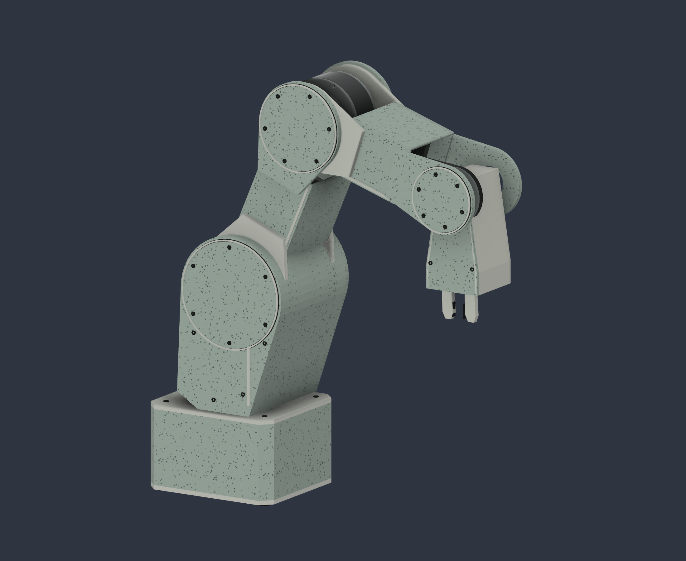

# greenarm-robot-arm

Work in progress: a desktop robot arm with stepper motors and 3D-printable 11:1 cycloidal gearboxes, designed in Fusion 360 from a Python generator.



## Design

- Four joints plus a gripper: a NEMA 23 at the shoulder, NEMA 17s for the base, elbow and wrist, and an MG996R servo driving the gripper.
- Two-disc cycloidal reducers (11:1) with my own profiles at the shoulder and elbow. Pins, shafts and bearings are metal; the housings are printable.
- The elbow and wrist motors sit inside the arm segments and drive their joints through internal belts.
- Flat, chamfered housings with removable service covers. Base 130 × 116 × 78 mm; 175 mm shoulder–elbow and 155 mm elbow–wrist.
- One design spec (`GreenArm-03/Design-spec.json`) drives both the previews and the Fusion 360 script, which builds the full assembly (12 components, 4 joints) in a new document.

## Files

| Path | Contents |
|---|---|
| `GreenArm-03/` | Current revision: `GreenArm-03.f3d`, `GreenArm-03.step`, renders, Python generator and tests, design review |
| `GreenArm-02/` | Previous revision: shoulder reducer as a separate STEP, reducer research, budget, validation plan |
| `CleanArm-01/` | First layout concept |

The design notes inside each folder are in Romanian.

The Python side — cycloid profile math, periodic splines, mesh and GLB export, a CPU preview renderer — has unit tests:

```bash
cd GreenArm-03
PYTHONPATH=. python3 -m unittest discover -s tests -p 'test_*.py'   # 36 tests
```

To rebuild the model, add the `GreenArm-03/` folder in Fusion under *Utilities → Scripts and Add-Ins* and run `GreenArm-03`.

## Printing

Not ready to print. The housings are planned in PLA (the marbled green in the renders); print settings will be set after the first test joint.

## Status

Concept CAD. It builds in Fusion with no errors, but full range-of-motion checks, belt routing, bearing fits, load and torque calculations and a physical test joint are still to do.

## License

[MIT](LICENSE)
